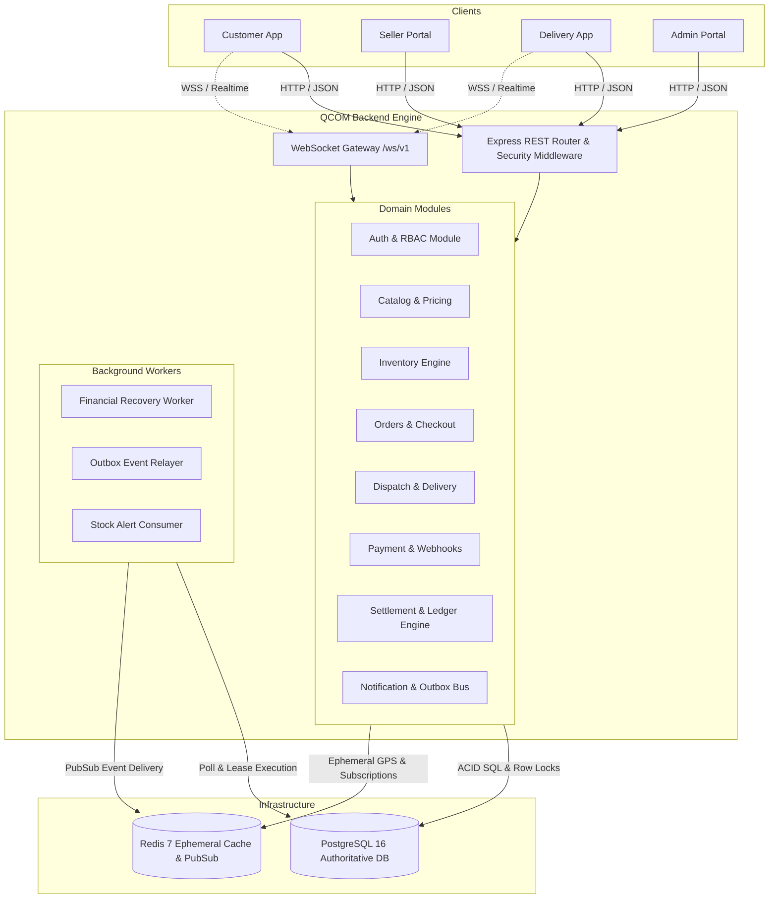

# QCOM Backend Architecture Specification

**Architecture Style:** Modular Monolith (Single-Process, Multi-Domain Engine)  
**Authoritative Store:** PostgreSQL 16  
**Ephemeral / PubSub Cache:** Redis 7  
**Gateway & Real-Time:** Express 4.x + `ws` WebSocket Server  
**Target Environment:** Containerized Node.js (Docker / Cloud Run)  

---

## 1. System Topology & Architecture Diagram

---

## 2. Component Inventory & Module Responsibilities

| Module | Source Path | Primary Responsibility | Authoritative Tables |
| :--- | :--- | :--- | :--- |
| **Auth & RBAC** | `src/modules/auth`, `src/modules/rbac` | Phone OTP authentication, JWT generation, user sessions, role permissions | `users`, `auth_sessions`, `otp_challenges`, `roles`, `permissions` |
| **Catalog & Pricing** | `src/modules/catalog`, `src/modules/pricing` | Product master, merchant store catalog, dynamic delivery and tax pricing calculation | `products`, `merchants`, `pricing_rules`, `statutory_tax_rules` |
| **Inventory** | `src/modules/inventory` | Multi-store stock tracking, selective reservations, zero-oversell row locking | `merchant_inventory`, `inventory_reservations`, `stock_alerts` |
| **Orders** | `src/modules/orders` | Checkout orchestration, order state machine, cancellation & compensation | `orders`, `order_items` |
| **Dispatch & Delivery**| `src/modules/dispatch`, `src/modules/delivery` | Rider proximity discovery, trip broadcasting, delivery OTP handshakes | `delivery_trips`, `rider_profiles`, `rider_locations` |
| **Payments** | `src/modules/payments` | Payment provider abstraction, durable webhook deduplication, refund state machine | `payment_intents`, `payment_attempts`, `webhook_events`, `refunds` |
| **Settlement & Ledger**| `src/modules/settlements`, `src/modules/ledger` | Double-entry journal accounting, merchant payouts, rider earnings, statutory withholding (TDS/TCS) | `journal_batches`, `journal_entries`, `accounts`, `seller_payouts`, `rider_payouts` |
| **Outbox & Events** | `src/modules/outbox`, `src/modules/notifications` | Transactional outbox event publishing, SMS/push notification queues | `outbox_events`, `notifications` |
| **Realtime** | `src/modules/realtime` | WebSocket connection lifecycle, private channel authorization, ephemeral GPS telemetry | Ephemeral (Redis / Memory) |
| **Recovery** | `src/modules/recovery` | Lease-based financial recovery worker for stalled transactions and reconciliation | `payment_intent_recovery_leases` |

---

## 3. Request Flow & Transaction Boundaries

1. **Client Request:** Validated against input schemas (Zod/custom validators) in Express route controllers.
2. **Authentication Middleware:** Validates JWT signature and active session record in `auth_sessions`.
3. **RBAC Authorization:** Evaluates granular permissions (`orders:create`, `merchants:inventory:read`, etc.) and enforces tenant isolation (`merchant_id`).
4. **Service Execution & Atomic DB Transaction:** Services execute within `transaction(async (client) => { ... })`. For critical updates, row-level locks (`FOR UPDATE`) are acquired.
5. **Outbox Emission:** Event payloads are inserted into `outbox_events` as part of the same SQL transaction.
6. **Response Dispatch:** HTTP 200/201 response emitted to client; background worker picks up outbox records asynchronously.

---

## 4. Multi-Instance & Scaling Strategy

- **Stateless HTTP Layer:** Backend instances run statelessly behind a standard load balancer.
- **Distributed Lock Management:** PostgreSQL advisory locks (`pg_advisory_lock`) and leasing tables prevent concurrent worker conflicts across instances.
- **Redis Pub/Sub Backplane:** Multi-instance WebSocket broadcasting uses Redis Pub/Sub channels to ensure real-time messages reach clients connected to any node.
