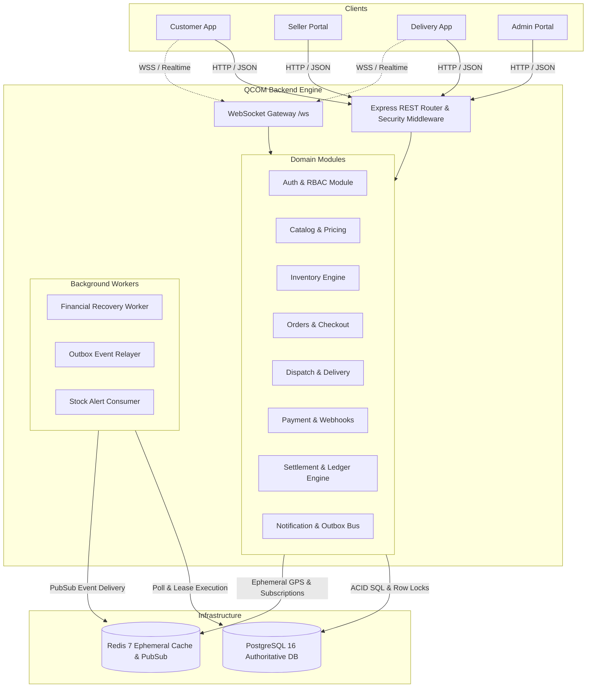

# QCOM Backend Architecture Specification

**Architecture Style:** Modular Monolith (Single-Process, Multi-Domain Engine)  
**Authoritative Store:** PostgreSQL 16  
**Ephemeral / PubSub Cache:** Redis 7.0.15 (`redis:7.0.15-alpine` pinned for dev/CI; Managed HA Redis `>= 7.0.15` in production)  
**Gateway & Real-Time:** Express 4.x + `ws` WebSocket Server  
**Target Environment:** Containerized Node.js (Docker / Cloud Run)  

---

## 1. System Topology & Architecture Diagram

---

## 2. Component Inventory & Module Responsibilities

| Module | Source Path | Primary Responsibility | Authoritative Tables |
| :--- | :--- | :--- | :--- |
| **Auth & RBAC** | `src/modules/auth`, `src/modules/rbac` | Phone OTP / Admin Scrypt authentication, JWT & session versioning, dynamic RBAC | `users`, `auth_sessions`, `refresh_tokens`, `otp_challenges`, `roles`, `permissions` |
| **Catalog & Pricing** | `src/modules/catalog`, `src/modules/pricing` | Product master, decimal-safe (`bignumber.js`) GST/Cess pricing (`tax_inclusive`/`tax_exclusive`), dynamic `indian_states` Place of Supply, atomic coupons & promotions (`couponPromotionService`), DB carts (`cartService`) | `products`, `merchants`, `indian_states`, `tax_rate_configs`, `pricing_calculation_snapshots`, `coupons`, `coupon_redemptions`, `promotions`, `promotion_applications`, `carts`, `cart_items` |
| **Inventory** | `src/modules/inventory` | Multi-store stock tracking, selective reservations, zero-oversell row locking | `store_inventory`, `inventory_reservations`, `seller_stock_alerts` |
| **Orders & Invoices** | `src/modules/orders`, `src/modules/invoices` | Checkout orchestration with single-use quote (`converted_at`), quote ownership/merchant/`409 PRICE_CHANGED` protection, crash-safe 3-phase return QC (`RETURN_QC_IN_PROGRESS`), prorated credit notes (`uq_credit_notes_return_type`), fail-closed service GST & honest `irn: null` | `orders`, `order_items`, `order_returns`, `order_return_items`, `gst_invoices`, `invoices`, `credit_notes`, `credit_note_line_items` |
| **Dispatch & Delivery**| `src/modules/dispatch`, `src/modules/delivery` | Rider proximity discovery, trip broadcasting, delivery OTP handshakes | `delivery_trips`, `riders`, `dispatch_assignments`, `dispatch_offers` |
| **Payments** | `src/modules/payments` | Payment provider abstraction (no gateway selected), durable webhook deduplication, refund state machine | `payment_intents`, `payment_attempts`, `webhook_events`, `refunds` |
| **Settlement & Ledger**| `src/modules/settlements`, `src/modules/ledger` | Double-entry journal accounting (including COA `5040` grant & return reversal `reversed_platform_subsidy`), merchant payouts, rider earnings, statutory withholding (TDS/TCS) | `general_ledger_accounts`, `general_ledger_entries`, `order_settlement_allocations`, `seller_payouts`, `rider_payouts` |
| **Outbox & Events** | `src/modules/outbox`, `src/modules/notifications` | Transactional outbox event publishing, push notification queues | `outbox_events`, `notification_campaigns`, `notification_deliveries` |
| **Realtime** | `src/modules/realtime` | WebSocket connection lifecycle, private channel authorization, ephemeral GPS telemetry | Ephemeral (Redis / Memory) |
| **Recovery & Reconciliation** | `src/modules/recovery`, `src/modules/reconciliation` | Lease-based financial recovery worker and read-only audit reconciliation (Checks 1–14: payment, COD `13–13F`, pricing/GST/coupons/invoices/credit notes/COA 5040/GL `14A–14J`) | `payment_intents`, `reconciliation_runs`, `reconciliation_discrepancies` |

---

## 3. Request Flow & Transaction Boundaries

1. **Client Request & Transport Guards:** Requests pass Helmet headers, fail-closed CORS (`credentials: false` when wildcard `*`), CIDR-verified IP resolution (`TRUST_PROXY_CIDRS`), Redis-backed sliding-window rate limiters, and input sanitization.
2. **Authentication & `token_version` Middleware:** Validates JWT signature (`JWT_ACCESS_SECRET` / `JWT_SECRET` alias), checks active `auth_sessions` record, enforces `is_suspended = FALSE`, and validates `token_version` across both HTTP and WebSocket upgrades.
3. **RBAC & Object-Level Authorization:** Evaluates granular permissions (`RequirePermission` / `requireRole`), privilege-escalation boundaries (`SUPER_ADMIN` protection), and strict object ownership (`requireOrderOwnership`, `requireMerchantOwnership`, `requireRiderOwnership`).
4. **Service Execution & Atomic DB Transaction:** Services execute within `transaction(async (client) => { ... })`. For critical updates (inventory, OTP consumption, refresh rotation, payouts), row-level locks (`FOR UPDATE`) are acquired.
5. **Outbox Emission:** Event payloads are inserted into `outbox_events` as part of the same SQL transaction.
6. **Response Dispatch & Error Sanitization:** Production HTTP 500 errors return sanitized messages (`safeErrorMessage`); audit logs automatically scrub credentials and tokens before persistence.

---

## 4. Multi-Instance & Scaling Strategy

- **Stateless HTTP Layer:** Backend instances run statelessly behind a standard load balancer.
- **Distributed Lock Management:** PostgreSQL advisory locks (`pg_advisory_lock`) and leasing tables prevent concurrent worker conflicts across instances.
- **Redis Pub/Sub Backplane:** Multi-instance WebSocket broadcasting uses Redis Pub/Sub (`qcom:ws:broadcast`) both for real-time order telemetry and cross-instance `SESSION_REVOKED` / `USER_LOGOUT_ALL` WebSocket disconnect propagation.
- **Related Security Specification:** See [SECURITY.md](./SECURITY.md).

